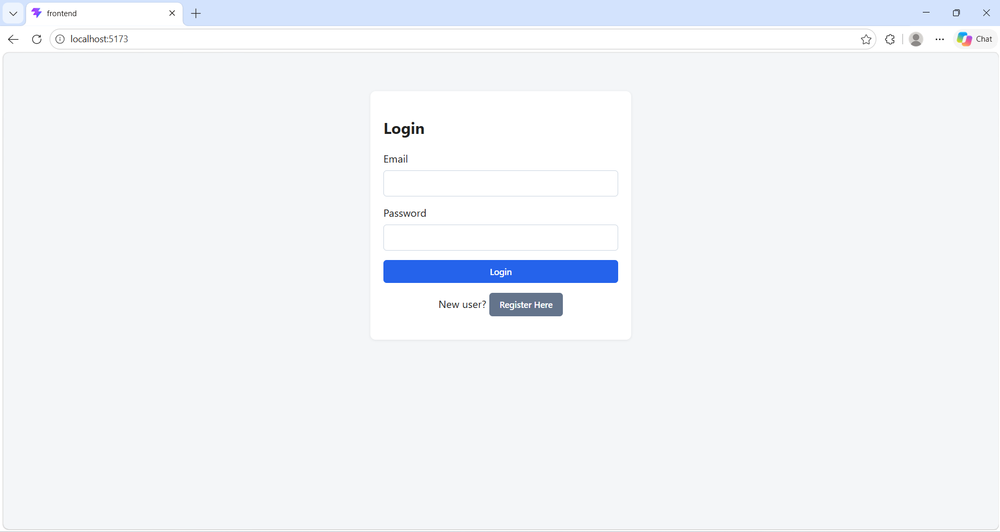
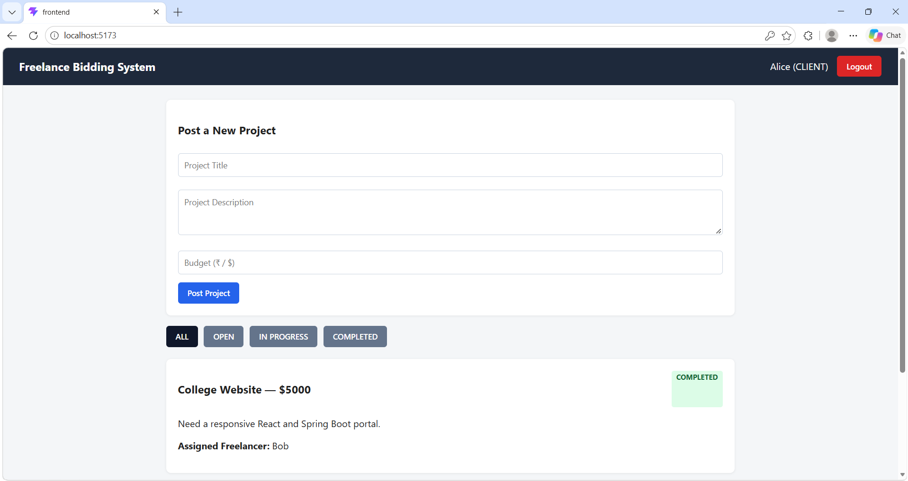
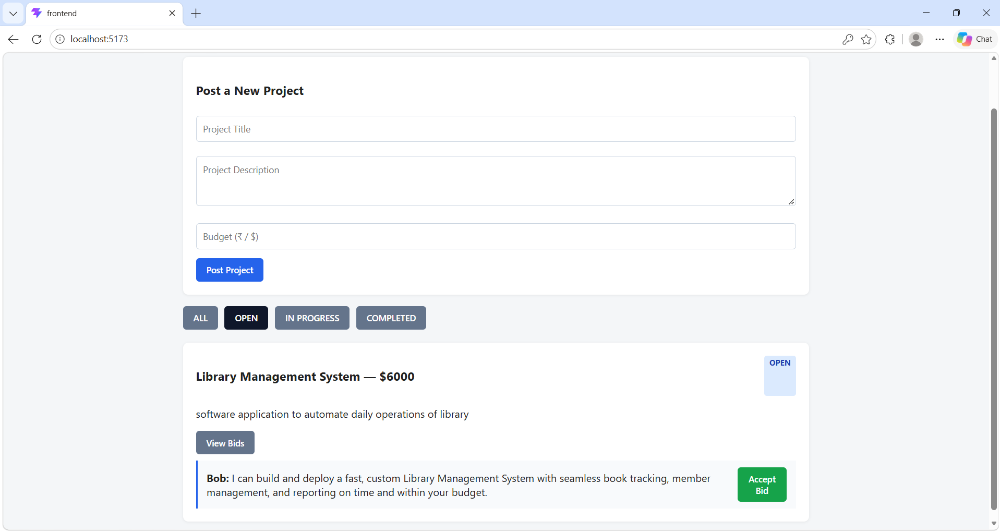
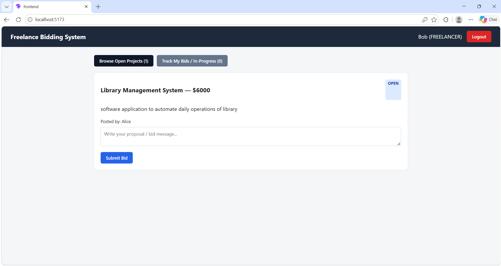
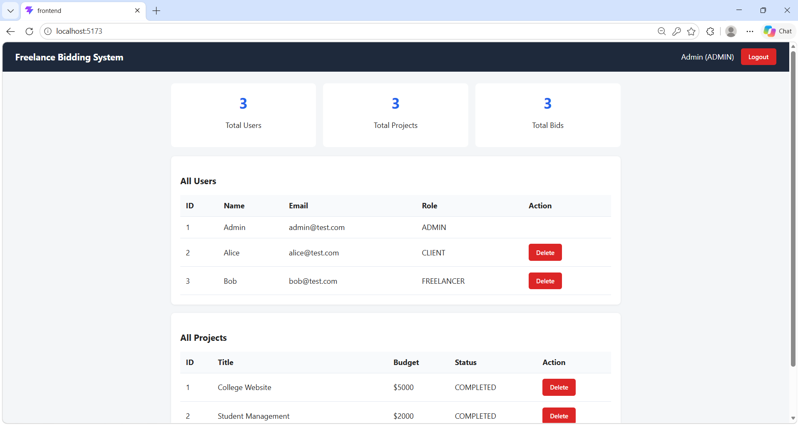

# Freelance Project Bidding System

A full-stack web application that connects **Clients** looking to get projects done with **Freelancers** ready to bid on them, overseen by an **Admin** dashboard. Built as a monolithic full-stack project using **React.js (Vite)**, **Java Spring Boot**, and **PostgreSQL**.

---

## Tech Stack

* **Frontend:** React.js (bootstrapped with Vite), Axios, Custom CSS
* **Backend:** Java, Spring Boot (Spring Web, Spring Data JPA)
* **Database:** PostgreSQL (managed via pgAdmin)
* **Tools:** VS Code, Postman, pgAdmin 4

---

## Features by User Role

### 1. Client
* **Post Projects:** Create new project listings with title, description, and budget.
* **Manage Projects:** Filter and track posted projects across three stages (`OPEN`, `IN_PROGRESS`, `COMPLETED`).
* **Review & Accept Bids:** View incoming freelancer proposals on `OPEN` projects and accept a bid, which automatically assigns the freelancer, moves the project to `IN_PROGRESS`, and rejects competing bids.
* **Complete Projects:** Mark `IN_PROGRESS` projects as `COMPLETED` once work is delivered.

### 2. Freelancer
* **Browse Open Projects:** View all available `OPEN` projects posted by clients.
* **Submit Bids:** Send a pitch/proposal message directly on open projects.
* **Track Active Work:** Monitor projects currently assigned and `IN_PROGRESS`.

### 3. Admin
* **System Overview:** View real-time counts of total registered users, projects, and submitted bids.
* **User & Project Moderation:** View all users and projects in structured tables with administrative delete controls.

---

## Project Structure

```text
Freelance-project-bidding-system/
├── backend/                     # Spring Boot REST API
│   └── src/main/java/com/example/backend/
│       ├── controller/          # Auth, Project, Bid, and Admin REST Controllers
│       ├── model/               # JPA Entities (User, Project, Bid)
│       ├── repository/          # Spring Data JPA Repositories
│       └── BackendApplication.java
├── frontend/                    # React + Vite Application
│   └── src/
│       ├── components/          # Auth, ClientDashboard, FreelancerDashboard, AdminDashboard
│       ├── App.jsx              # Role-based routing and state management
│       └── App.css              # Application styling
├── screenshots/                 # Project UI screenshots
└── README.md
```

---

## Database Schema

The application uses 3 relational tables in PostgreSQL (`freelance_db`), auto-generated via Hibernate/JPA:

| Table | Key Columns | Description |
| :--- | :--- | :--- |
| `users` | `id`, `name`, `email`, `password`, `role` | Stores `CLIENT`, `FREELANCER`, and `ADMIN` accounts. |
| `projects` | `id`, `title`, `description`, `budget`, `status`, `client_id`, `freelancer_id` | Tracks project lifecycle (`OPEN`, `IN_PROGRESS`, `COMPLETED`). |
| `bids` | `id`, `message`, `status`, `project_id`, `freelancer_id` | Stores freelancer proposals (`PENDING`, `ACCEPTED`, `REJECTED`). |

---

## API Endpoints Overview

### Authentication (`/api/auth`)
* `POST /register` — Register a new Client or Freelancer
* `POST /login` — Authenticate user and return user profile & role

### Projects (`/api/projects`)
* `POST /client/{clientId}` — Create a new project
* `GET /client/{clientId}` — Get all projects posted by a specific client
* `GET /open` — Fetch all `OPEN` projects for freelancers
* `GET /freelancer/{freelancerId}/in-progress` — Fetch active `IN_PROGRESS` projects for a freelancer
* `PUT /{projectId}/complete` — Mark an `IN_PROGRESS` project as `COMPLETED`

### Bids (`/api/bids`)
* `POST /project/{projectId}/freelancer/{freelancerId}` — Submit a bid proposal on a project
* `GET /project/{projectId}` — View all bids submitted to a project
* `PUT /{bidId}/accept` — Accept a bid and assign the freelancer to the project

### Admin (`/api/admin`)
* `GET /dashboard` — Fetch system metrics, all users, and all projects
* `DELETE /users/{id}` — Remove a user account
* `DELETE /projects/{id}` — Remove a project listing

---

## Setup & Installation

### Prerequisites
* Java JDK 17 or higher & Maven
* Node.js (v18+) & npm
* PostgreSQL & pgAdmin

### 1. Database Setup
1. Open pgAdmin and create a new database named `freelance_db`.
2. Update `backend/src/main/resources/application.properties` with your PostgreSQL username and password.

### 2. Run the Backend

```bash
cd backend
./mvnw spring-boot:run
```

The Spring Boot server will start on `http://localhost:8080`.

### 3. Run the Frontend

```bash
cd frontend
npm install
npm run dev
```

The React app will be available at `http://localhost:5173`.

---

## Screenshots

### Login / Register


### Client Dashboard


### Client – Review & Accept Bids


### Freelancer Dashboard


### Admin Dashboard
